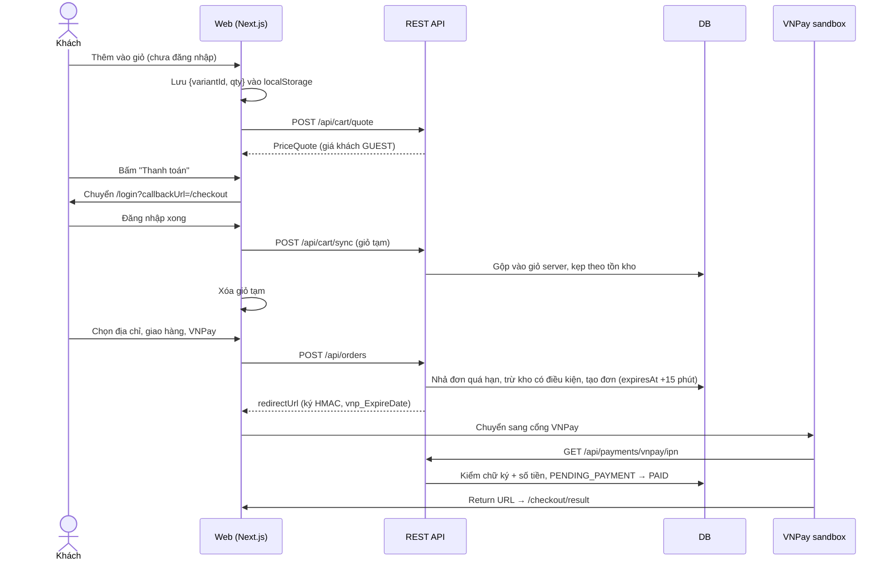
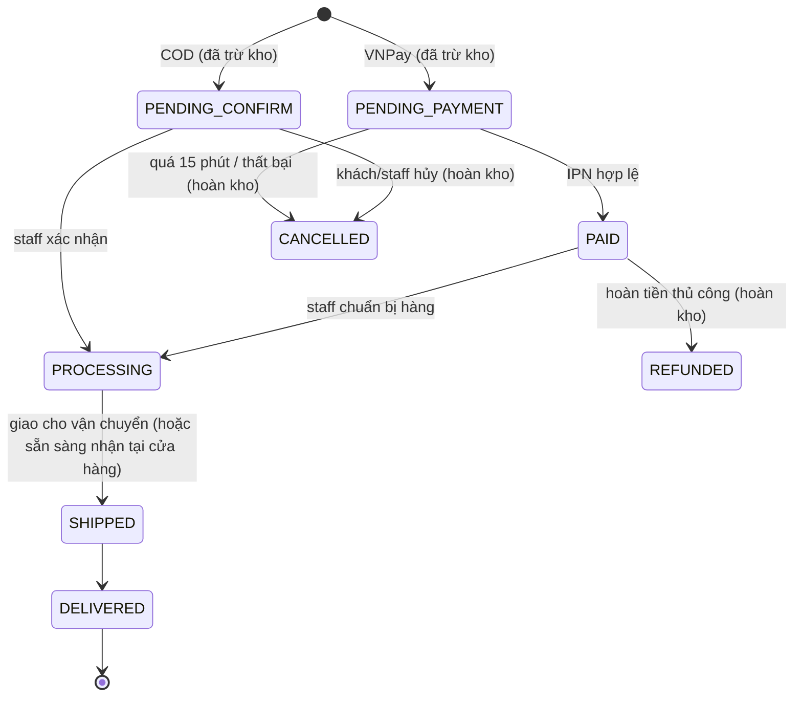

# Implementation Plan – Website TMĐT cho chủ đề X (CO3027)

Sep 26, 2026 · @Khoa

## 1. Mục tiêu và phạm vi

Tài liệu này là phiên bản dành cho người code của kế hoạch BTL: đủ chi tiết để mỗi thành viên (hoặc AI agent làm theo `AGENTS.md`) nhận một task và làm đúng ngay. Các quyết định kiến trúc, lý do chọn, và phần báo cáo nằm trong doc **Kế hoạch Bài tập lớn CO3027**; khi hai doc khác nhau, doc kế hoạch chính là gốc.

**Code phải đáp ứng các mục rubric sau**

| Mục | Điểm | Yêu cầu với code |
| --- | --- | --- |
| 4.1 | 1,5 | Website đã deploy có đủ: quản lý sản phẩm, giỏ hàng, thanh toán (mô phỏng), quản lý đơn, tùy chọn giao hàng, bảo mật |
| 4.2 | 0,5 | Source code, database (dump hoặc migrate + seed), hướng dẫn cài đặt |
| 5 | 1,0 | Tính năng nâng cao: giá động/cá nhân hóa, dashboard KPI, gợi ý sản phẩm, mobile-first |
| 2.4 (gián tiếp) | — | Dashboard và GA4 là "cách đo KPI" mà báo cáo viện dẫn |
| 3.1 (gián tiếp) | — | Giao diện code bám theo Figma 5 trang: Home, danh sách, chi tiết, giỏ, checkout |

**Mốc thời gian:** code freeze **8/11/2026**; README, dump database và source code nộp cùng báo cáo trước 20h ngày 13/11 (hạn chót 23h59 ngày 14/11).

**Trong phạm vi**

- Xem sản phẩm không cần đăng nhập; giỏ tạm cho khách chưa đăng nhập; đăng nhập bắt buộc ở checkout và trang cá nhân.
- Checkout có tùy chọn giao hàng, giữ kho 15 phút, VNPay sandbox và COD.
- Admin: sản phẩm, tồn kho, đơn hàng, dashboard KPI.
- Pricing Engine, gợi ý sản phẩm, analytics, tuân thủ (footer, chính sách, cookie).

**Ngoài phạm vi:** microservices, app native, marketplace nhiều người bán, API vận chuyển thật, chatbot chạy thật, thu tiền thật. Các tính năng P2 (coupon, email, review/wishlist, OpenAPI, E2E…) chỉ làm khi dư thời gian.

**Trạng thái X:** đã chốt — **ATELIER**, thời trang may sẵn và phụ kiện (áo khoác, đầm, len, quần tây, túi, trang sức), biến thể theo size thay vì màu. Mọi task đánh dấu **\[X\]** có thể triển khai với dữ liệu thật trong `prisma/seed-data.json`.

## 2. Tech stack và biến môi trường

Một repo Next.js full-stack theo mô hình lai: **đọc bằng Server Components, ghi qua REST Route Handlers bảo vệ bằng `withAuth`**. Không dùng Server Actions cho thao tác ghi. Dùng bản ổn định mới nhất của mỗi thư viện tại thời điểm khởi tạo và khóa version trong `package.json`.

| Hạng mục | Lựa chọn | Ghi chú |
| --- | --- | --- |
| Ngôn ngữ / runtime | TypeScript (strict), Node.js LTS | `pnpm` làm package manager |
| Framework | Next.js App Router | Route Handlers chạy Node runtime (Prisma, ký HMAC) |
| UI | Tailwind CSS v4 + shadcn/ui, `lucide-react` | Mobile-first; màu, font qua CSS variables |
| Form + validation | React Hook Form + Zod | Schema Zod dùng chung client/server trong `lib/validation` |
| DB + ORM | PostgreSQL trên Neon (Singapore) + Prisma | Tiền lưu bằng `Int` (VNĐ), không dùng số thực |
| Xác thực | Better Auth (email/password, vai trò) + plugin JWT | Web: cookie phiên; Postman/client khác: `Bearer` JWT |
| Ảnh | Ảnh seed trong `public/`; ảnh admin upload qua Vercel Blob | `next/image` lo resize, WebP |
| Thanh toán | VNPay sandbox (tự viết adapter), COD | Không lưu dữ liệu thẻ |
| Analytics | Bảng `AnalyticsEvent` riêng + GA4 (sau đồng ý cookie) | Dashboard KPI đọc từ bảng riêng |
| Test | Vitest (unit, integration với DB test), Playwright (P2) | DB test: Neon branch hoặc Postgres Docker |
| Deploy / CI | Vercel Hobby (region `sin1`), GitHub Actions | CI: lint, typecheck, test; Vercel build và preview mỗi PR |

**Biến môi trường** (khai báo trong `.env.example`, giá trị thật chỉ nằm trên Vercel và máy cá nhân)

| Biến | Dùng cho | Bắt buộc |
| --- | --- | --- |
| `DATABASE_URL`, `DIRECT_URL` | Prisma (pooled / migrate) | Có |
| `APP_URL` | URL gốc, dùng cho kiểm tra `Origin` và URL trả về của VNPay | Có |
| `BETTER_AUTH_SECRET`, `BETTER_AUTH_URL` | Better Auth | Có |
| `VNP_TMN_CODE`, `VNP_HASH_SECRET`, `VNP_PAY_URL`, `VNP_RETURN_URL` | VNPay sandbox | Có |
| `BLOB_READ_WRITE_TOKEN` | Upload ảnh admin | Có (từ Sprint 2) |
| `CRON_SECRET` | Endpoint nhả kho tùy chọn | Không |
| `NEXT_PUBLIC_GA_ID` | GA4 | Không |
| `RESEND_API_KEY` | Email (P2) | Không |

Preview và production dùng secret khác nhau (đặc biệt `BETTER_AUTH_SECRET`), để token ở môi trường này không dùng được ở môi trường kia.

## 3. Cấu trúc repo và quy ước code

Logic nghiệp vụ chỉ nằm trong `lib/`. Trang (`app/`) và API (`app/api/`) là lớp mỏng gọi vào `lib/`, nhờ vậy Server Components và REST dùng chung một logic và test được mà không cần chạy web.

```
app/
  (shop)/                     # storefront, công khai trừ account/checkout
    page.tsx                  # Home
    c/[slug]/page.tsx         # danh sách theo danh mục + bộ lọc
    p/[slug]/page.tsx         # chi tiết sản phẩm + gợi ý
    cart/page.tsx             # giỏ (giỏ tạm hoặc giỏ server)
    checkout/page.tsx         # cần đăng nhập
    checkout/result/page.tsx  # kết quả thanh toán
    account/orders/page.tsx   # đơn hàng của tôi
    (legal)/...               # chính sách đổi trả, vận chuyển, thanh toán, bảo mật
  (auth)/login, register
  admin/                      # layout kiểm vai trò STAFF/ADMIN
    products/, orders/, analytics/
  api/                        # REST Route Handlers (mục 6)
lib/
  auth/        # better-auth config, withAuth, getCurrentUser
  catalog/     # truy vấn sản phẩm, bộ lọc
  cart/        # giỏ server, sync giỏ tạm
  order/       # placeOrder, releaseExpiredOrders, state machine
  payment/     # PaymentProvider, vnpay.ts, cod.ts
  pricing/     # calculatePrice (hàm thuần) + rules
  shipping/    # phương thức giao hàng, tính phí
  recommend/   # sản phẩm tương tự, thường mua cùng
  analytics/   # ghi sự kiện, tính KPI
  validation/  # Zod schemas dùng chung
  db.ts        # Prisma client singleton
  http.ts      # apiOk, apiError, parse body
  errors.ts    # AppError và các mã lỗi
components/
  ui/          # shadcn (không sửa logic)
  shop/, admin/
prisma/
  schema.prisma, migrations/, seed.ts, seed-data.json
tests/
  unit/, integration/, e2e/ (P2)
AGENTS.md, README.md, .env.example
```

**Quy ước**

| Chủ đề | Quy ước |
| --- | --- |
| Tiền | Luôn là số nguyên VNĐ (`Int`); định dạng chỉ ở UI bằng `Intl.NumberFormat('vi-VN')` |
| Thời gian | Lưu UTC; hiển thị theo `Asia/Ho_Chi_Minh`; hàm nghiệp vụ nhận `now` làm tham số để test được |
| ID | `cuid()` cho mọi bảng; URL dùng `slug` |
| Đặt tên | File `kebab-case.ts`; hàm `camelCase`; enum Prisma `UPPER_SNAKE` |
| Lỗi | `lib/` ném `AppError(code, message)`; Route Handler chuyển thành JSON lỗi chuẩn (mục 6) |
| Validation | Mọi input từ client đi qua Zod trước khi vào `lib/` |
| Giá | Client không bao giờ gửi giá; server tính lại bằng `calculatePrice` |
| Ghi dữ liệu | Chỉ qua REST Route Handler bọc `withAuth` (trừ endpoint công khai đã liệt kê và IPN VNPay) |
| Transaction | Thao tác đụng tới kho và đơn hàng phải nằm trong `prisma.$transaction` |
| Nội dung của X | Không hardcode tên sản phẩm, danh mục; lấy từ DB hoặc `seed-data.json` |

**`AGENTS.md`** (tạo ở Sprint 0) tóm tắt cho AI agent: stack ở mục 2, cấu trúc và quy ước ở trên, lệnh chạy (`pnpm dev`, `pnpm test`, `pnpm db:migrate`, `pnpm db:seed`), và các điều cấm:

- Không tin giá, số tiền hay vai trò do client gửi lên.
- Không tạo endpoint ghi mà không qua `withAuth`, không dùng Server Actions để ghi.
- Không sửa migration đã merge; muốn đổi schema thì tạo migration mới.
- Không commit secret; không log số tiền kèm thông tin cá nhân.
- Code mới trong `lib/pricing`, `lib/order`, `lib/payment`, `lib/auth` phải có test.

## 4. Data model

Các bảng `User`, `Session`, `Account`, `Verification`, `Jwks` do Better Auth sinh ra (bằng CLI của Better Auth, xuất sang Prisma); nhóm chỉ thêm cột `role` và các quan hệ. Bản nháp dưới đây là phần nghiệp vụ; chi tiết cú pháp chốt khi làm task IMP-04.

```prisma
enum Role { CUSTOMER STAFF ADMIN }
enum OrderStatus { PENDING_PAYMENT PENDING_CONFIRM PAID PROCESSING SHIPPED DELIVERED CANCELLED REFUNDED }
enum PaymentMethod { VNPAY COD }
enum PaymentStatus { PENDING SUCCESS FAILED }
enum PriceRuleType { TIME_WINDOW STOCK_LEVEL SEGMENT }

// User (Better Auth) + role Role @default(CUSTOMER), addresses, cart, orders

model Address {
  id String @id @default(cuid())
  userId String
  recipient String
  phone String
  line String
  ward String
  province String
  isDefault Boolean @default(false)
}

model Category {
  id String @id @default(cuid())
  parentId String?
  slug String @unique
  name String
  filters Json   // { variantAxes: string[], filters: string[] }
  products Product[]
}

model Product {
  id String @id @default(cuid())
  categoryId String
  slug String @unique
  name String
  brand String?
  description String
  attributes Json            // thuộc tính riêng của X, có GIN index (migration SQL)
  status String @default("ACTIVE")
  variants ProductVariant[]
  images ProductImage[]
  createdAt DateTime @default(now())
}

model ProductVariant {
  id String @id @default(cuid())
  productId String
  sku String @unique
  options Json               // { size: "M", color: "Đen" }
  basePrice Int              // VNĐ
  stock Int                  // số lượng còn bán được (đã trừ phần đang giữ)
}

model ProductImage { id String @id @default(cuid()) productId String url String alt String sortOrder Int @default(0) }

model Cart     { id String @id @default(cuid()) userId String @unique items CartItem[] updatedAt DateTime @updatedAt }
model CartItem { id String @id @default(cuid()) cartId String variantId String qty Int @@unique([cartId, variantId]) }

model ShippingMethod {
  code String @id            // STANDARD | EXPRESS | PICKUP
  name String
  fee Int
  etaDaysMin Int
  etaDaysMax Int
  freeFrom Int?              // miễn phí khi tạm tính >= mức này
  active Boolean @default(true)
}

model Order {
  id String @id @default(cuid())
  code String @unique        // mã đơn hiển thị, dùng làm vnp_TxnRef
  userId String
  status OrderStatus
  paymentMethod PaymentMethod
  shippingMethodCode String
  subtotal Int
  discount Int
  shippingFee Int
  total Int
  addressSnapshot Json
  pricingSnapshot Json       // luật giá đã áp cho từng dòng
  expiresAt DateTime?        // chỉ với PENDING_PAYMENT
  createdAt DateTime @default(now())
  items OrderItem[]
  payments Payment[]
  @@index([status, expiresAt])
}

model OrderItem { id String @id @default(cuid()) orderId String variantId String nameSnapshot String unitPrice Int qty Int }

model Payment {
  id String @id @default(cuid())
  orderId String
  provider PaymentMethod
  txnRef String @unique
  amount Int
  status PaymentStatus
  rawPayload Json?
  createdAt DateTime @default(now())
}

model PriceRule {
  id String @id @default(cuid())
  name String
  type PriceRuleType
  condition Json             // xem mục 5.1
  percentOff Int             // 1..50
  priority Int @default(0)
  active Boolean @default(true)
}

model AnalyticsEvent {
  id String @id @default(cuid())
  type String                // page_view | product_view | add_to_cart | begin_checkout | purchase
  sessionId String
  userId String?
  payload Json?
  createdAt DateTime @default(now())
  @@index([type, createdAt])
}

model AuditLog { id String @id @default(cuid()) actorId String action String entity String before Json? after Json? createdAt DateTime @default(now()) }
```

**Seed:** `prisma/seed.ts` đọc `seed-data.json` (danh mục, sản phẩm, biến thể, ảnh), tạo 3 `ShippingMethod`, 3 `PriceRule` mẫu, 1 tài khoản ADMIN, 1 STAFF, 2 CUSTOMER cho demo. Chạy lại được nhiều lần (xóa dữ liệu nghiệp vụ cũ trước khi nạp).

## 5. Module contracts

Nhóm viết các chữ ký hàm dưới đây trước (kèm test), rồi mới giao phần thân hàm cho từng người hoặc AI agent. Đây là "hợp đồng" giữa các module; đổi chữ ký phải báo cả nhóm.

### 5.1 Pricing (`lib/pricing`) – hàm thuần, không đọc DB

```ts
type Segment = 'GUEST' | 'NEW' | 'RETURNING';   // NEW: 0 đơn PAID; RETURNING: ≥ 1 đơn PAID

type PriceInput = {
  items: { variantId: string; qty: number }[];
  segment: Segment;
  shippingMethodCode?: string;
  now: Date;
};
type PriceContext = {
  variants: Map<string, { basePrice: number; stock: number; categoryId: string; name: string }>;
  rules: PriceRule[];                 // chỉ rule active
  shippingMethods: ShippingMethod[];
};
type PriceQuote = {
  lines: { variantId: string; qty: number; unitBase: number; unitFinal: number;
           appliedRule?: string; lineTotal: number }[];
  subtotal: number; discount: number; shippingFee: number; total: number;
};
export function calculatePrice(input: PriceInput, ctx: PriceContext): PriceQuote;
```

| Loại luật | `condition` | Áp dụng khi |
| --- | --- | --- |
| `TIME_WINDOW` | `{ start, end, daysOfWeek?, categoryIds? }` | `now` nằm trong khung giờ (giờ Việt Nam) |
| `STOCK_LEVEL` | `{ minStock, categoryIds? }` | `stock ≥ minStock` (hàng tồn nhiều) |
| `SEGMENT` | `{ segment }` | `input.segment` khớp |

Quy tắc kết hợp: **mỗi dòng chỉ áp một luật có mức giảm lớn nhất** (hòa thì theo `priority`), không cộng dồn; mức giảm tối đa 50%; làm tròn `unitFinal` xuống bội 1.000đ. Phí ship lấy từ `ShippingMethod`, bằng 0 khi `subtotal ≥ freeFrom`. Giá hiển thị ở trang sản phẩm dùng cùng hàm này, nên khách thấy đúng giá sẽ trả.

### 5.2 Cart (`lib/cart`)

```ts
// Giỏ tạm (client): localStorage key 'guest_cart' = { variantId, qty }[]; không lưu giá
export function quoteGuestCart(items, now): Promise<PriceQuote>;              // segment = GUEST
export function getCart(userId): Promise<CartWithItems>;
export function upsertCartItem(userId, variantId, qty): Promise<CartWithItems>; // qty ≤ stock
export function removeCartItem(userId, variantId): Promise<CartWithItems>;
export function syncGuestCart(userId, guestItems): Promise<CartWithItems>;
// gộp: cộng qty theo variantId, kẹp theo stock, bỏ biến thể không còn tồn tại
```

### 5.3 Order (`lib/order`)

```ts
export function placeOrder(args: {
  userId: string; addressId: string; shippingMethodCode: string;
  paymentMethod: 'VNPAY' | 'COD'; now: Date;
}): Promise<Order>;
// 1) releaseExpiredOrders(now)  2) tính giá bằng calculatePrice
// 3) trong 1 transaction: trừ kho có điều kiện từng dòng (updateMany where stock >= qty),
//    tạo Order + OrderItem, xóa giỏ; dòng nào count = 0 thì ném OUT_OF_STOCK và rollback
// 4) VNPAY: status PENDING_PAYMENT, expiresAt = now + 15 phút; COD: PENDING_CONFIRM

export function releaseExpiredOrders(now: Date): Promise<number>;
// updateMany status PENDING_PAYMENT → CANCELLED where expiresAt < now, rồi cộng lại kho; chạy lặp an toàn

export function transitionOrder(orderId, to: OrderStatus, actor): Promise<Order>;
// chỉ cho phép các cạnh trong state machine (mục 7); sang CANCELLED thì hoàn kho; ghi AuditLog
```

### 5.4 Payment (`lib/payment`)

```ts
interface PaymentProvider {
  createPayment(order: Order, ctx: { ipAddr: string; now: Date }): Promise<{ redirectUrl?: string }>;
  verifyCallback(params: URLSearchParams): { valid: boolean; txnRef: string; amount: number; success: boolean };
}
// vnpay.ts: sắp xếp tham số theo tên, ký HMAC-SHA512 bằng VNP_HASH_SECRET,
//           vnp_Amount = total × 100, vnp_TxnRef = order.code, vnp_ExpireDate = order.expiresAt
// cod.ts:   createPayment không redirect; đơn chờ staff xác nhận
export function handleVnpayIpn(params: URLSearchParams): Promise<{ RspCode: string; Message: string }>;
// kiểm chữ ký → tìm đơn theo txnRef → kiểm số tiền → nếu đã xử lý thì trả mã "đã xác nhận"
// → thành công: PENDING_PAYMENT → PAID (updateMany có điều kiện trạng thái); ghi Payment
```

Mã phản hồi IPN (`RspCode`) theo tài liệu VNPay sandbox; A kiểm tra lại khi làm IMP-15.

### 5.5 Shipping, Recommend, Analytics

```ts
// lib/shipping
export function listShippingMethods(): Promise<ShippingMethod[]>;

// lib/recommend
export function similarProducts(productId: string, limit = 8): Promise<ProductCard[]>;
// cùng danh mục; điểm = số thuộc tính trùng + độ gần giá (±30%); loại sản phẩm hết hàng
export function boughtTogether(productId: string, limit = 4): Promise<ProductCard[]>;
// đếm số lần cùng xuất hiện trong đơn PAID/DELIVERED; thiếu dữ liệu thì dùng similarProducts

// lib/analytics
export function track(type: EventType, ctx: { sessionId; userId? }, payload?): Promise<void>;
export function getKpis(range: { from: Date; to: Date }): Promise<Kpis>;
```

| KPI trên dashboard | Cách tính (trong khoảng thời gian) |
| --- | --- |
| Lượt truy cập | Số `sessionId` khác nhau có `page_view` |
| Funnel | Số phiên có `product_view` → `add_to_cart` → `begin_checkout` → `purchase` |
| Tỷ lệ chuyển đổi | Phiên có `purchase` / lượt truy cập |
| Doanh thu, giá trị đơn trung bình | Tổng và trung bình `total` của đơn PAID trở đi (COD tính khi DELIVERED) |
| Tỷ lệ bỏ giỏ | Phiên có `add_to_cart` mà không có `purchase` / phiên có `add_to_cart` |
| Tỷ lệ mua lại | Khách có ≥ 2 đơn thành công / khách có ≥ 1 đơn thành công |
| Doanh thu theo luật giá | Gom theo `appliedRule` trong `pricingSnapshot`, dùng cho báo cáo 2.2 và Phần 5 |

`sessionId` là cookie ngẫu nhiên chỉ được tạo sau khi khách đồng ý cookie; chưa đồng ý thì không ghi sự kiện.

### 5.6 Auth (`lib/auth`)

```ts
export function getCurrentUser(headers: Headers): Promise<AuthUser | null>; // cookie phiên hoặc Bearer JWT
export function withAuth(roles: Role[] | 'ANY', handler: (req, user: AuthUser, ctx) => Promise<Response>);
// thứ tự: CSRF (request ghi mang cookie phải có Origin = APP_URL) → xác thực (401) → vai trò (403)
// JWT: kiểm chữ ký qua JWKS của plugin, exp, iss, aud
// API admin đọc lại role từ DB, không chỉ tin claim
```

## 6. REST API

Mọi endpoint nằm dưới `/api`, nhận và trả JSON. Trang storefront không gọi các endpoint đọc mà truy vấn `lib/` trực tiếp; các endpoint đọc công khai tồn tại cho Postman và client khác.

**Định dạng phản hồi**

```json
// thành công
{ "data": { ... } }
// lỗi
{ "error": { "code": "OUT_OF_STOCK", "message": "Sản phẩm Áo M - Đen chỉ còn 1", "details": { "variantId": "..." } } }
```

| Mã lỗi | HTTP | Khi nào |
| --- | --- | --- |
| `VALIDATION_ERROR` | 400 | Zod từ chối input |
| `UNAUTHENTICATED` | 401 | Thiếu/sai phiên hoặc JWT |
| `FORBIDDEN` | 403 | Sai vai trò, không phải chủ đơn, hoặc bị chặn CSRF |
| `NOT_FOUND` | 404 | Không có tài nguyên |
| `OUT_OF_STOCK` | 409 | Không đủ tồn kho khi thêm giỏ hoặc đặt hàng |
| `INVALID_TRANSITION` | 409 | Chuyển trạng thái đơn không hợp lệ |
| `RATE_LIMITED` | 429 | Vượt giới hạn request |
| `INTERNAL` | 500 | Lỗi không lường trước (không trả stack trace) |

**Danh sách endpoint**

| Method + path | Quyền | Input chính | Output |
| --- | --- | --- | --- |
| `/api/auth/*` | Public | (Better Auth: đăng ký, đăng nhập, đăng xuất, lấy JWT, JWKS) | — |
| `GET /api/products` | Public | `category, q, filters, sort, page` | Danh sách + tổng số |
| `GET /api/products/:slug` | Public | — | Sản phẩm, biến thể, giá đã áp luật |
| `GET /api/products/:slug/recommendations` | Public | — | `similar[]`, `boughtTogether[]` |
| `GET /api/categories`, `GET /api/shipping-methods` | Public | — | Danh sách |
| `POST /api/cart/quote` | Public, rate-limit | `items[]` của giỏ tạm | `PriceQuote` |
| `POST /api/cart/sync` | Customer | `items[]` của giỏ tạm | Giỏ server sau gộp |
| `GET/POST/PATCH/DELETE /api/cart/items` | Customer | `variantId, qty` | Giỏ server |
| `POST /api/checkout/quote` | Customer | `shippingMethodCode` | `PriceQuote` |
| `POST /api/orders` | Customer | `addressId, shippingMethodCode, paymentMethod` | Đơn + `redirectUrl` (nếu VNPay) |
| `GET /api/me/orders`, `GET /api/orders/:id` | Customer (chỉ đơn của mình) | — | Đơn hàng |
| `POST /api/orders/:id/pay/vnpay` | Customer là chủ đơn | — | `redirectUrl` mới (nếu đơn còn hạn) |
| `GET /api/payments/vnpay/return` | Public | Tham số VNPay | Redirect tới `/checkout/result` |
| `GET /api/payments/vnpay/ipn` | VNPay (checksum) | Tham số VNPay | `{ RspCode, Message }` |
| `GET/POST/PATCH /api/admin/products[/:id]` | Staff, Admin | Sản phẩm, biến thể, tồn kho | Sản phẩm |
| `POST /api/admin/uploads` | Staff, Admin | File ảnh | URL Vercel Blob |
| `GET /api/admin/orders`, `PATCH /api/admin/orders/:id/status` | Staff, Admin | `status` | Đơn |
| `GET /api/admin/analytics/kpis` | Admin | `from, to` | `Kpis` |
| `GET/POST/PATCH /api/admin/price-rules` (P2) | Admin | Luật giá | Luật giá |
| `POST /api/events` | Public (có đồng ý cookie), rate-limit | `type, payload` | 204 |
| `GET /api/cron/release-expired` (tùy chọn) | Header `CRON_SECRET` | — | Số đơn đã nhả |

**Mẫu handler**

```ts
// app/api/admin/orders/[id]/status/route.ts
export const PATCH = withAuth(['STAFF', 'ADMIN'], async (req, user, { params }) => {
  const { status } = orderStatusSchema.parse(await req.json());
  const order = await transitionOrder((await params).id, status, user);
  return apiOk(order);
});
```

## 7. Luồng chính

Ba luồng dưới đây là xương sống của demo mục 4.1; mỗi luồng có một kịch bản kiểm thử thủ công tương ứng ở Sprint 4.

### 7.1 Giỏ tạm → đăng nhập → checkout → thanh toán



Điểm cần nhớ: Return URL chỉ để hiển thị, trang kết quả đọc trạng thái đơn từ DB (IPN có thể đến trước hoặc sau). Nếu IPN chưa đến, trang hiển "Đang xác nhận thanh toán" và tự kiểm tra lại sau vài giây.

### 7.2 State machine của đơn hàng



| Cạnh | Ai được chuyển | Tác động phụ |
| --- | --- | --- |
| PENDING\_PAYMENT → PAID | Chỉ IPN | Ghi `Payment` SUCCESS; sự kiện `purchase` |
| PENDING\_PAYMENT → CANCELLED | Hệ thống (nhả kho lười) hoặc IPN thất bại | Hoàn kho |
| PENDING\_CONFIRM → PROCESSING | Staff, Admin | AuditLog; sự kiện `purchase` cho COD |
| PENDING\_CONFIRM → CANCELLED | Khách (chủ đơn) hoặc Staff | Hoàn kho; AuditLog |
| PAID/PROCESSING → SHIPPED → DELIVERED | Staff, Admin | AuditLog |
| PAID → REFUNDED | Admin | Hoàn kho; AuditLog |

### 7.3 Tùy chọn giao hàng (mô phỏng)

Giá trị mẫu, chỉnh lại theo X và bảng chi phí ở mục 2.2 của báo cáo:

| Mã | Tên | Phí | Thời gian | Ghi chú |
| --- | --- | --- | --- | --- |
| `STANDARD` | Giao tiêu chuẩn | 30.000đ | 3–5 ngày | Miễn phí từ 500.000đ |
| `EXPRESS` | Giao nhanh | 50.000đ | 1–2 ngày | Chỉ nội thành TP.HCM (kiểm theo tỉnh trong địa chỉ) |
| `PICKUP` | Nhận tại cửa hàng | 0đ | Ngay khi sẵn sàng | Không cần địa chỉ giao |

## 8. Bảo mật và kiểm thử

Bảo mật là một trong 6 thành phần bắt buộc của mục 4.1. Test tập trung vào chỗ sai là mất tiền hoặc lộ dữ liệu, không nhắm tới độ phủ cao.

### 8.1 Checklist bảo mật

- [ ] Mọi endpoint ghi đi qua `withAuth`; API admin đọc lại vai trò từ DB
- [ ] Kiểm quyền sở hữu ở mọi endpoint có `:id` của khách (đơn, địa chỉ) để chống IDOR
- [ ] Request ghi mang cookie phải có `Origin` khớp `APP_URL` (CSRF); cookie `httpOnly`, `Secure`, `SameSite=Lax`
- [ ] Zod cho mọi input; Prisma cho mọi truy vấn (không nối chuỗi SQL)
- [ ] Giá và số tiền chỉ tính ở server; IPN kiểm chữ ký và số tiền, xử lý idempotent
- [ ] Rate-limit: đăng nhập (Better Auth), `/api/cart/quote`, `/api/events`
- [ ] Security headers: CSP, HSTS, `X-Frame-Options`, `Referrer-Policy`
- [ ] Không trả stack trace cho client; không log mật khẩu, token, secret
- [ ] AuditLog cho mọi thao tác admin (sản phẩm, tồn kho, trạng thái đơn)
- [ ] Upload ảnh: chỉ nhận định dạng ảnh, giới hạn dung lượng, chỉ Staff/Admin
- [ ] Banner đồng ý cookie trước khi bật GA4 và ghi sự kiện

### 8.2 Test bắt buộc

| Nhóm | Test case | Loại |
| --- | --- | --- |
| Pricing | Mỗi loại luật áp đúng điều kiện; ngoài điều kiện thì không áp; nhiều luật thì chọn mức giảm lớn nhất; trần 50%; làm tròn 1.000đ; miễn phí ship từ `freeFrom` | Unit |
| VNPay | Ký và kiểm chữ ký với bộ tham số mẫu; chữ ký sai bị từ chối; `vnp_Amount` = tổng × 100 | Unit |
| IPN | Chữ ký sai; số tiền sai; gọi 2 lần chỉ cập nhật 1 lần; đơn đã hủy | Integration |
| Giữ kho | Hai `placeOrder` song song tranh món cuối: một thành công, một `OUT_OF_STOCK`; tồn kho không âm | Integration |
| Nhả kho | Đơn quá hạn bị hủy và hoàn kho; chạy 2 lần không hoàn kho gấp đôi | Integration |
| Giỏ | Sync gộp đúng số lượng, kẹp theo tồn kho, bỏ biến thể không tồn tại | Integration |
| `withAuth` | Không đăng nhập → 401; sai vai trò → 403; khác origin → 403; JWT hết hạn / sửa chữ ký → 401 | Integration |
| Quyền sở hữu | Customer A đọc đơn của Customer B → 403 | Integration |
| State machine | Cạnh hợp lệ đi qua; cạnh không hợp lệ → `INVALID_TRANSITION`; hủy thì hoàn kho | Unit + integration |
| E2E (P2) | Giỏ tạm → đăng nhập → checkout COD → admin xác nhận | Playwright |

Integration test chạy trên DB riêng (Neon branch `test` hoặc Postgres Docker), reset bằng `prisma migrate reset` trước mỗi lần chạy. CI chạy unit test mọi PR; integration test chạy khi PR đụng `lib/order`, `lib/payment`, `lib/cart`, `lib/auth`.

### 8.3 Kịch bản kiểm tra thủ công trước khi nộp

- [ ] Khách vãng lai xem, lọc, thêm giỏ; đăng nhập; giỏ được giữ nguyên
- [ ] Thanh toán VNPay sandbox thành công và thất bại; đơn đúng trạng thái
- [ ] Đơn VNPay bỏ dở quá 15 phút → bị hủy, kho được hoàn
- [ ] COD với cả 3 phương thức giao hàng; phí ship đúng
- [ ] Admin tạo sản phẩm có ảnh, sửa tồn kho, chuyển trạng thái đơn
- [ ] Luật giá khung giờ / tồn kho / phân khúc hiển thị đúng trên trang sản phẩm và checkout
- [ ] Dashboard KPI có số liệu sau các lần mua thử
- [ ] Toàn bộ luồng trên điện thoại thật; Lighthouse mobile ≥ 90

## 9. Backlog implementation

Chỉ gồm việc code, lấy từ mục 6 của kế hoạch chính (giờ và owner giữ nguyên). Mỗi task là một issue/PR; ID dùng trong tên nhánh (`feat/IMP-14-place-order`). Task **\[X\]** chỉ làm sau khi chốt X.

### Sprint 0 (28/9 – 4/10): nền móng

| ID | Task | Tiêu chí nghiệm thu | Owner | Giờ | Phụ thuộc |
| --- | --- | --- | --- | --- | --- |
| IMP-01 | Khởi tạo repo: Next.js, TypeScript strict, Tailwind, shadcn/ui, Prisma, Better Auth, ESLint/Prettier | `pnpm dev` chạy; cấu trúc thư mục đúng mục 3 | A | 3 | — |
| IMP-02 | CI GitHub Actions + deploy Vercel (`sin1`) + Neon (Singapore) | PR có CI xanh và bản preview; `main` deploy production | A | 3 | IMP-01 |
| IMP-03 | Schema v1 (mục 4) + migration + seed 5–10 sản phẩm giả, 3 phương thức giao hàng, tài khoản demo | `pnpm db:seed` chạy lặp được; production đọc được DB | A | 4 | IMP-01 |
| IMP-04 | `AGENTS.md`, `.env.example`, template PR | Có đủ nội dung mục 3; cả nhóm đã đọc | C | 1 | IMP-01 |
| IMP-05 | Layout chung mobile-first: header, footer, theme qua CSS variables | Đúng trên màn 375px và 1280px | B | 3 | IMP-01 |
| IMP-06 | Đăng ký VNPay sandbox, lưu khóa vào Vercel | Có `VNP_TMN_CODE`, `VNP_HASH_SECRET`; đã khai URL IPN production | A | 1 | IMP-02 |

### Sprint 1 (5/10 – 18/10): giao dịch cốt lõi

| ID | Task | Tiêu chí nghiệm thu | Owner | Giờ | Phụ thuộc |
| --- | --- | --- | --- | --- | --- |
| IMP-10 | Better Auth + plugin JWT + vai trò; `withAuth`, `getCurrentUser`; trang login/register | Test `withAuth` ở mục 8.2 xanh; Postman gọi API với Bearer JWT được | A | 6 | IMP-03 |
| IMP-11 | `calculatePrice` v1: giá gốc + phí giao hàng | Unit test phí ship và `freeFrom` xanh | C | 3 | IMP-03 |
| IMP-12 | Giỏ tạm `localStorage` + `POST /api/cart/quote` | Khách vãng lai thêm/sửa/xóa, thấy giá đúng; rate-limit hoạt động | C | 4 | IMP-11 |
| IMP-13 | Giỏ server + `POST /api/cart/sync` | Test giỏ ở mục 8.2 xanh | C | 5 | IMP-10 |
| IMP-14 | `placeOrder` + `releaseExpiredOrders` + `POST /api/orders` | Test giữ kho và nhả kho xanh | A | 7 | IMP-11, IMP-13 |
| IMP-15 | VNPay adapter, Return, IPN | Test VNPay và IPN xanh; thanh toán sandbox thành công trên production | A | 7 | IMP-14, IMP-06 |
| IMP-16 | UI giỏ hàng: drawer + trang giỏ, dùng chung giỏ tạm và giỏ server | Đúng Figma; không nháy khi chuyển từ giỏ tạm sang giỏ server | B | 5 | IMP-12 |
| IMP-17 | Trang kết quả thanh toán | Hiển đúng 3 trạng thái: thành công, thất bại, đang xác nhận | B | 2 | IMP-15 |
| IMP-18 | Trang chủ (khung) + branding theo Figma **\[X\]** | Đúng Figma trên mobile và desktop | B | 4 | IMP-05 |

### Sprint 2 (19/10 – 1/11): shop X + admin

| ID | Task | Tiêu chí nghiệm thu | Owner | Giờ | Phụ thuộc |
| --- | --- | --- | --- | --- | --- |
| IMP-20 | COD: tạo đơn `PENDING_CONFIRM` | Đặt COD thành công, kho bị trừ | A | 2 | IMP-14 |
| IMP-21 | `lib/shipping` + `GET /api/shipping-methods`; EXPRESS chỉ nội thành, PICKUP không cần địa chỉ | 3 phương thức tính phí đúng trong quote | A | 3 | IMP-11 |
| IMP-22 | Admin đơn hàng: danh sách, lọc theo trạng thái, `transitionOrder` | Test state machine xanh; hủy thì hoàn kho; có AuditLog | A | 6 | IMP-14 |
| IMP-23 | Admin sản phẩm: danh sách, tạo/sửa, biến thể, tồn kho, upload ảnh Vercel Blob | Staff tạo được sản phẩm có ảnh và biến thể; có AuditLog | A | 6 | IMP-10 |
| IMP-24 | Ghi sự kiện funnel + GA4 + banner đồng ý cookie | Chưa đồng ý thì không ghi; đồng ý rồi thì 5 loại sự kiện được ghi | A | 3 | IMP-03 |
| IMP-25 | UI checkout: địa chỉ, chọn giao hàng, báo giá, chọn thanh toán, chuyển hướng đăng nhập | Luồng 7.1 chạy trọn vẹn trên mobile | B | 7 | IMP-15, IMP-21 |
| IMP-26 | Trang danh sách + bộ lọc theo `Category.filters` **\[X\]** | Lọc, sắp xếp, phân trang; URL phản ánh bộ lọc | B | 6 | IMP-29 |
| IMP-27 | Trang chi tiết: gallery, chọn biến thể, thông số, giá sau luật **\[X\]** | Biến thể hết hàng bị khóa; giá trùng với checkout | B | 6 | IMP-29 |
| IMP-28 | Trang "Đơn hàng của tôi" (P1) | Chỉ thấy đơn của mình; xem chi tiết và trạng thái | B | 2 | IMP-14 |
| IMP-29 | Dữ liệu X trong `seed-data.json`: danh mục, `filters`, 40–60 sản phẩm, ảnh **\[X\]** | Seed chạy sạch; mọi sản phẩm có ảnh và ít nhất 1 biến thể còn hàng | C | 6 | IMP-03 |
| IMP-30 | Pricing Engine: 3 loại luật trong `calculatePrice`; seed 3 luật mẫu | Test pricing ở mục 8.2 xanh; `pricingSnapshot` lưu luật đã áp | C | 6 | IMP-11 |

### Sprint 3 (2/11 – 8/11): Phần 5 + hoàn thiện, code freeze 8/11

| ID | Task | Tiêu chí nghiệm thu | Owner | Giờ | Phụ thuộc |
| --- | --- | --- | --- | --- | --- |
| IMP-40 | Gợi ý "Sản phẩm tương tự" + "Thường mua cùng" trên trang chi tiết và giỏ | Không gợi ý chính sản phẩm đang xem hoặc hàng hết; có fallback khi thiếu đơn | A | 4 | IMP-27 |
| IMP-41 | Dashboard KPI + funnel trong admin (mục 5.5) | Số liệu khớp với các lần mua thử; chọn được khoảng thời gian | A | 4 | IMP-24 |
| IMP-42 | Harden bảo mật: rate-limit, security headers, rà checklist 8.1 | Mọi mục 8.1 được tick | A | 4 | — |
| IMP-43 | Tuân thủ: footer thông tin chủ sở hữu, 4 trang chính sách, banner "demo học tập" **\[X\]** | Có link từ footer; nội dung khớp báo cáo 1.1 | B | 3 | IMP-05 |
| IMP-44 | Tối ưu mobile, Lighthouse, SEO kỹ thuật (metadata, sitemap, robots, JSON-LD) | Lighthouse mobile ≥ 90 ở Home, danh sách, chi tiết | B | 3 | IMP-26, IMP-27 |

### Sprint 4 (9/11 – 14/11): đóng gói

| ID | Task | Tiêu chí nghiệm thu | Owner | Giờ | Phụ thuộc |
| --- | --- | --- | --- | --- | --- |
| IMP-50 | Sửa lỗi + chạy kịch bản kiểm tra 8.3 trên production | Mọi mục 8.3 được tick | A | 3 | Code freeze |
| IMP-51 | README + `.env.example` + dump database (mục 10.3) | Một người không tham gia code cài được từ đầu theo README | A | 3 | IMP-50 |

### P2 – chỉ làm khi dư thời gian (theo thứ tự)

| ID | Task | Giờ | Phục vụ |
| --- | --- | --- | --- |
| IMP-60 | Tìm kiếm full-text (Postgres) | 3 | 4.1 |
| IMP-61 | E2E Playwright cho luồng 7.1 (COD) | 4 | 4.1 |
| IMP-62 | UI admin cho luật giá | 3 | 5 |
| IMP-63 | OpenAPI + bộ request Postman demo JWT | 3 | 4.1 |
| IMP-64 | Email xác nhận đơn (Resend) | 3 | 4.1 |
| IMP-65 | Coupon, review/wishlist, PWA, MoMo | 3–5 mỗi mục | 4.1 |

**Tổng giờ code (P0/P1):** khoảng 134 giờ. **Đường găng:** IMP-03 → IMP-11 → IMP-14 → IMP-15 → IMP-25; trễ bất kỳ task nào trong chuỗi này là trễ luồng mua hàng, nên các task này được review và merge trước.

## 10. Quy trình, deploy và sản phẩm nộp

### 10.1 Git và Definition of Done

- **Nhánh:** `main` (production) ← `dev` (tích hợp) ← `feat/IMP-xx-ten-ngan`. Merge `dev` vào `main` cuối mỗi sprint hoặc khi cần test VNPay trên production.
- **Commit:** Conventional Commits (`feat:`, `fix:`, `test:`, `chore:`), ghi ID task.
- **PR:** mô tả thay đổi, ID task, ảnh chụp UI (nếu có), ghi rõ phần nào AI agent hỗ trợ.

* [ ] PR được ít nhất 1 người khác review; CI xanh
* [ ] Đạt tiêu chí nghiệm thu của task; chạy đúng trên bản preview, cả mobile lẫn desktop
* [ ] Endpoint ghi mới đi qua `withAuth` và Zod; test bắt buộc (mục 8.2) liên quan đã có
* [ ] Người nộp PR giải thích được toàn bộ code; ghi nhật ký AI nếu có dùng
* [ ] Chụp màn hình tính năng và gửi cho người viết phần báo cáo liên quan

### 10.2 Deploy và migration

| Môi trường | Nguồn | Database | Ghi chú |
| --- | --- | --- | --- |
| Local | Máy cá nhân | Neon branch riêng hoặc Postgres Docker | VNPay qua ngrok/cloudflared nếu cần |
| Preview | Mỗi PR | Neon branch dùng chung cho preview | Không nhận IPN; header `noindex` |
| Production | `main` | Neon nhánh chính | Test VNPay đầy đủ ở đây |

- Build production chạy `prisma migrate deploy`; không bao giờ chạy `migrate dev` hay `migrate reset` trên production.
- Đổi schema = migration mới trong PR riêng, A review.
- Trước giờ demo hoặc khi giảng viên chấm: chạy lại seed nếu dữ liệu bẩn; mở trang trước vài phút để Neon thức dậy.

### 10.3 Sản phẩm nộp cho mục 4.2

- **Source code:** link repo (hoặc file nén theo yêu cầu giảng viên) tại commit đã gắn tag `v1.0-submission`.
- **Database:** `prisma/migrations` + `seed-data.json` + `seed.ts`; thêm file `database/dump.sql` (xuất bằng `pg_dump` từ production sau khi seed sạch và có vài đơn mẫu).
- **README** gồm:
  1. Giới thiệu ngắn, link website đã deploy, tài khoản demo (Admin, Staff, Customer) và thẻ test VNPay sandbox.
  2. Yêu cầu: Node.js LTS, pnpm, PostgreSQL (hoặc tài khoản Neon).
  3. Cài đặt: `pnpm install` → copy `.env.example` thành `.env` → `pnpm db:migrate` → `pnpm db:seed` (hoặc nạp `dump.sql`) → `pnpm dev`.
  4. Chạy test: `pnpm test`.
  5. Kiến trúc tóm tắt, cấu trúc thư mục, danh sách tính năng (đánh dấu tính năng tự làm và tính năng từ framework, khớp báo cáo 4.1).
  6. Ghi chú: website dùng gói miễn phí nên lần mở đầu có thể chậm vài giây.

### 10.4 Rủi ro kỹ thuật

| Rủi ro | Tác động | Giảm thiểu |
| --- | --- | --- |
| IPN sandbox không gọi về được | Kẹt đường găng ở IMP-15 | Làm IMP-02, IMP-06 ngay Sprint 0; test với ngrok; COD vẫn demo được |
| Better Auth + plugin JWT khác với tài liệu hoặc phần ví dụ cũ | IMP-10 trễ | Đọc tài liệu chính thức bản đang dùng; nếu plugin JWT vướng, tạm dùng cookie phiên cho mọi API và để Bearer JWT thành P2 |
| Prisma + Neon serverless hết kết nối | Lỗi ngẫu nhiên trên production | Dùng URL pooled cho runtime, `DIRECT_URL` cho migrate; Prisma client singleton |
| Race condition khi trừ kho | Bán vượt tồn kho | `updateMany` có điều kiện trong transaction + test song song (IMP-14) |
| Lệch giờ UTC và giờ Việt Nam | Luật giá khung giờ sai | Truyền `now` vào hàm; so sánh theo `Asia/Ho_Chi_Minh`; có test |
| Code do AI agent sinh ra sai ở chỗ nhạy cảm | Lỗi bảo mật hoặc tính tiền sai | Hợp đồng ở mục 5 viết trước; test mục 8.2 bắt buộc; người review đọc từng dòng `lib/payment`, `lib/order`, `lib/auth` |
| Thiếu giờ trước code freeze | Thiếu tính năng bắt buộc của 4.1 | Giữ đường găng trước; cắt P2, sau đó IMP-28 và IMP-44 trước khi đụng tới 6 thành phần bắt buộc |
