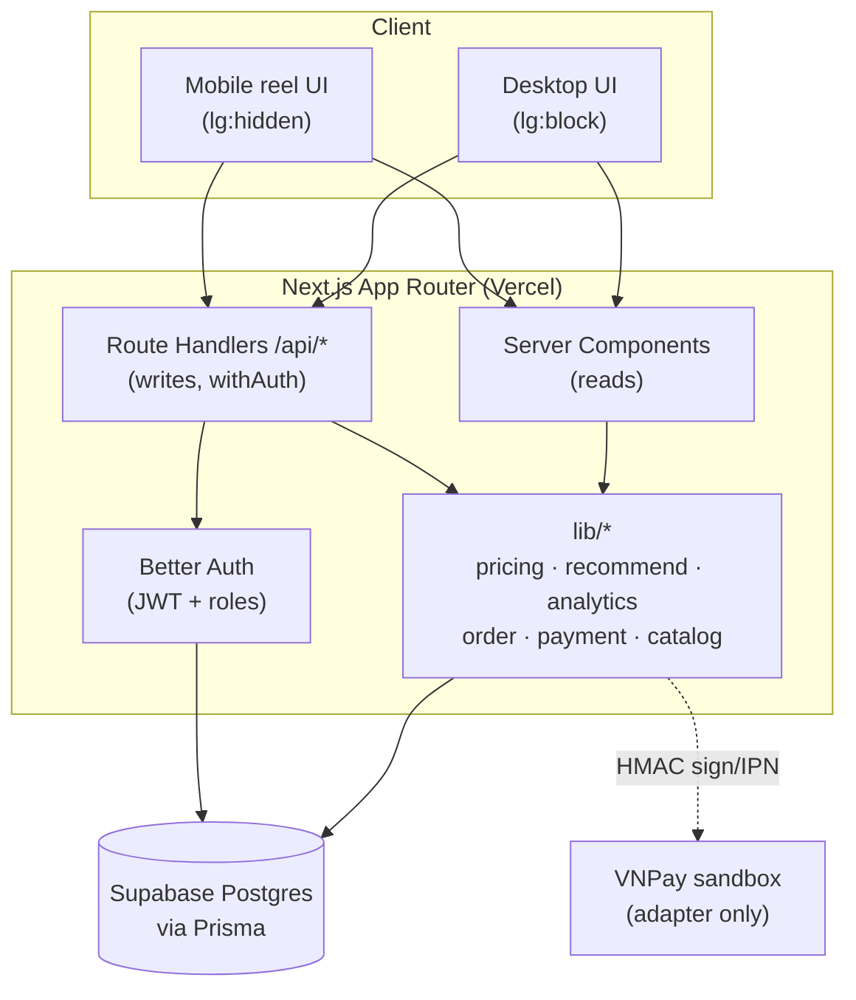

# ATELIER

A B2C Fashion E-Commerce platform that satisfied customer experience throughout the shopping process, while keep track of customer's behaviour base on their consents, for analytics and optimizing.

## What this is

A fashion e-commerce site that **re-imagines mobile shopping as a vertical-scroll experience**, swiping through products instead of the
traditional click-and-navigate web pattern that is brought over to mobile. The same backend and catalog power two distinct UIs:

- **Desktop** — a standard storefront with optimized UX UI, plus advance features.

- **Mobile** — a demo full-screen, swipeable. Home page is an Instagram-profile-style grid of all products/collections.

## Deploy

**https://atelier-neon-xi.vercel.app**

**https://atelier-neon-xi.vercel.app/mobile**

- Desktop UI: the URL above, opened on a laptop/desktop browser.
- Mobile UI: the same URL on an actual phone, **or** open
  `https://atelier-neon-xi.vercel.app/mobile` from a laptop — it embeds the
  real site inside an iPhone 16 Pro-sized frame so the mobile UI can be
  demoed without a phone.

## Core features

- **Catalog & product management** — categories, products, size variants,
  multi-image galleries; full CRUD in `/admin/products`.
- **Cart & checkout** — guest cart (merges into account on login), 15-minute
  stock hold at checkout, saved address book.
- **Payment** — COD (fully demoable) and a VNPay sandbox adapter (HMAC
  signing, IPN handling, state machine) included but not wired to a live
  sandbox transaction.
- **Order management** — admin order list/status, customer order history,
  self-cancel while still in the initial status.
- **Shipping options** — selectable shipping methods at checkout.
- **Security** — Better Auth (JWT + roles: Admin/Staff/Customer), route-level
  auth guards on mutating endpoints, cookie-gated analytics consent.

## Advanced features

- **Dynamic/personalized pricing** — rule-based pricing engine (`lib/pricing`)
  applying segment- and context-aware discounts at checkout, not flat prices.
- **KPI dashboard** — `/admin/analytics` reads real `AnalyticsEvent` data for
  revenue, visits, and a page-view → purchase conversion funnel.
- **Product recommendations** — "frequently bought together" (`lib/recommend`)
  computed from actual order history, falling back to same-category items.
- **Mobile-first reel UI** — the vertical-scroll feed described above, as a
  genuinely distinct UI from the desktop storefront rather than a responsive
  resize.
- **FAQ chat bubble** — a fixed-position chat widget answering a handful of
  canned questions (payment, shipping, cancellation, returns, order tracking).
  No AI model or backend call behind it today — it's a placeholder UI/UX slot
  for a real AI chatbot later, not a finished feature.

## Requirements

- Node.js LTS, pnpm (`corepack enable`)
- Docker Desktop (for local Postgres) — or your own Postgres/Supabase/Neon URL

## Run locally

```bash
pnpm install
cp .env.example .env       # defaults match docker-compose.yml, no edits needed
docker compose up -d       # starts local Postgres
pnpm db:migrate
pnpm db:seed                # demo accounts + sample catalog/order history
pnpm dev
```

Open http://localhost:3000.

> The deployed site uses a shared Supabase Postgres instead of local Docker —
> see the connection strings and gotchas documented in `.env.example`. Don't
> point your local `.env` at it unless you mean to: `pnpm db:seed` wipes and
> reloads shared data.

## Demo accounts (after seeding)

| Role | Email | Password |
| --- | --- | --- |
| Admin | admin@atelier.test | Password123! |
| Staff | staff@atelier.test | Password123! |
| Customer | customer1@atelier.test | Password123! |

Admin panel: `/admin` (not linked in nav — log in as Admin/Staff and use the
account menu, or go to the URL directly).

## Useful commands

| Command | Purpose |
| --- | --- |
| `pnpm dev` | Dev server |
| `pnpm build` | Production build |
| `pnpm db:migrate` | Apply migrations (dev) |
| `pnpm db:seed` | Reload demo catalog + order/analytics history (repeatable) |
| `pnpm test` | Unit tests (Vitest) |
| `pnpm lint` | ESLint |
| `pnpm exec tsc --noEmit` | Type check |

## Architecture

Next.js App Router, full-stack: Server Components for reads, REST route
handlers (`app/api/*`) for writes, business logic in `lib/*`. Auth via Better
Auth (JWT + roles). Details in `AGENTS.md`.


